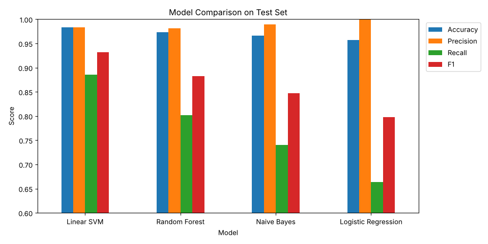
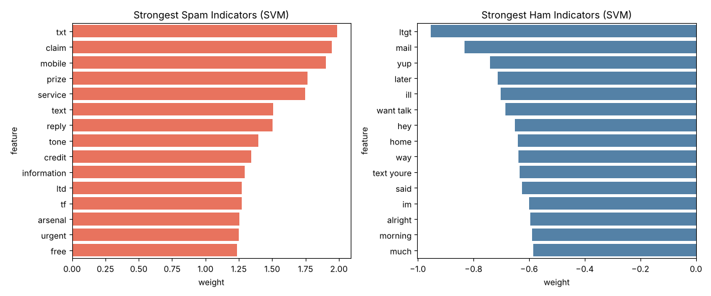
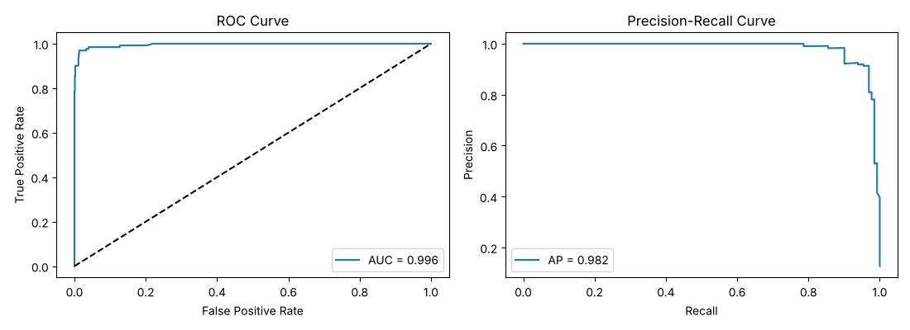

# SMS Spam Classification with SVM

A text classifier that sorts SMS messages into **spam** or **ham** (normal messages) using TF-IDF features and a Linear SVM. On top of the base model, the notebook runs five extra analyses to check whether the SVM is really the best choice and where it fails.

All code is kept simple: plain pandas, scikit-learn and matplotlib/seaborn, with comments, so it is easy to follow and change.

## Results at a glance

| Metric (test set, 1034 messages) | Score |
|---|---|
| Accuracy | 0.984 |
| Precision (spam) | 0.983 |
| Recall (spam) | 0.886 |
| F1 (spam) | 0.932 |
| ROC AUC | 0.996 |
| 5-fold CV accuracy | 0.979 |

The model almost never flags a real message as spam (2 cases), but it lets about 1 in 9 spam messages through (15 cases). Most of the advanced analysis is about that gap.

## Project structure

```
sms-spam-svm/
├── SMS_Spam_SVM.ipynb   # main notebook (already run, outputs saved)
├── README.md
├── requirements.txt
├── images/              # plots saved by the notebook
└── SMS.csv              # dataset, you add this (see below)
```

## Dataset

[SMS Spam Collection](https://www.kaggle.com/datasets/uciml/sms-spam-collection-dataset) from Kaggle (originally UCI).

- 5,572 messages, 403 duplicates removed, leaving 5,169
- 87.4% ham, 12.6% spam (imbalanced)
- Columns used: `v1` (label) and `v2` (message)

Download `spam.csv`, rename it to `SMS.csv` and put it in the project folder.

## How to run

**Locally**

```bash
pip install -r requirements.txt
jupyter notebook SMS_Spam_SVM.ipynb
```

Then run all cells. The first run downloads the NLTK stopwords and WordNet data.

**Google Colab**

Upload the notebook and run all cells. If `SMS.csv` is not found, an upload box appears so you can pick the file.

## What the notebook does

### Base pipeline

1. **EDA**: class counts, message length by class, word clouds
2. **Preprocessing**: lowercase, remove URLs, emails, digits and punctuation, drop stopwords, lemmatise
3. **Split**: 80/20, stratified so both sets keep the same spam ratio
4. **Model**: `TfidfVectorizer` (top 5000 unigrams and bigrams) + `LinearSVC`
5. **Tuning**: `GridSearchCV` over `C = [0.1, 1, 10]`, best is `C = 1`
6. **Cross validation** on the full data and a small `predict_sms()` function for new messages

### Advanced analysis (Section 7)

| # | Analysis | Question it answers |
|---|---|---|
| 7.1 | Confusion matrix, ROC and Precision-Recall curves | What kind of mistakes does the model make, and how well does it rank spam? |
| 7.2 | Model comparison | Does SVM beat Naive Bayes, Logistic Regression and Random Forest on the same features? |
| 7.3 | Top words and SVM weights | Which words mark a message as spam or ham? |
| 7.4 | Error analysis | What do the misclassified messages actually look like? |
| 7.5 | Class imbalance check | Can `class_weight='balanced'` or a lower threshold catch more spam? |

## Findings

**Model comparison.** Linear SVM wins on both the single test split and 5-fold CV.

| Model | Accuracy | Precision | Recall | F1 | CV F1 |
|---|---|---|---|---|---|
| Linear SVM | 0.9836 | 0.9831 | 0.8855 | 0.9317 | 0.9088 |
| Random Forest | 0.9729 | 0.9813 | 0.8015 | 0.8824 | 0.8733 |
| Naive Bayes | 0.9662 | 0.9898 | 0.7405 | 0.8472 | 0.8482 |
| Logistic Regression | 0.9574 | 1.0000 | 0.6641 | 0.7982 | 0.8091 |

Logistic Regression gets perfect precision only because it is very cautious; it misses a third of all spam. Random Forest comes second but takes roughly 20x longer to train.



**Words.** Spam relies on "txt", "claim", "mobile", "prize", "service", "urgent" and "free". Ham looks like casual chat: "later", "home", "hey", "yup", "morning".



**Errors.** The missed spam tends to be short or written like a personal message: adult chat lines, quiz texts, a "missed call alert". One message labelled spam reads like a genuine customer complaint about a phone bill, so a few "errors" are probably label noise in the dataset itself.

**Imbalance.** Only 12.6% of messages are spam, which pushes the SVM toward predicting ham.

| Option | Precision | Recall | F1 |
|---|---|---|---|
| Default SVM (threshold 0) | 0.983 | 0.886 | 0.932 |
| `class_weight='balanced'` | 0.922 | 0.901 | 0.911 |
| Threshold lowered to -0.3 | 0.918 | 0.939 | 0.928 |

Balancing helps recall a little but costs more precision than it gains. Lowering the decision threshold is the better lever: at -0.3 the model catches 5 more spam messages for almost the same F1.



## Limitations and next steps

- Preprocessing strips every digit, but spam often contains phone numbers and short codes (for example 87121). A simple "contains a number" feature would likely help.
- The dataset is small and dated (mostly UK texts from the 2000s), so slang and spam styles may not carry over to current messages.
- The threshold choice depends on what matters more for your use case: missing spam or blocking a real message.

## Plots

All figures are saved in `images/`:

| File | Content |
|---|---|
| `eda_counts.png` | Class counts and word count distribution |
| `wordclouds.png` | Spam and ham word clouds |
| `confusion_matrix.png` | Tuned SVM confusion matrix |
| `roc_pr_curves.png` | ROC and Precision-Recall curves |
| `model_comparison.png` | Four models compared |
| `top_words.png` | Most frequent spam and ham words |
| `spam_bigrams.png` | Most frequent spam word pairs |
| `svm_weights.png` | Strongest spam and ham indicators from the SVM |
| `imbalance_confusion.png` | Default vs balanced SVM |

## Requirements

Python 3.9+ and the packages in `requirements.txt`: pandas, numpy, matplotlib, seaborn, scikit-learn, nltk, wordcloud, jupyter.

